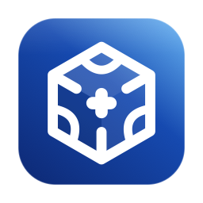

<div align="center">
    
    <h1>Ice++</h1>
    <p>macOS 菜单栏管理。隐藏图标、Ice Bar、预设、自动化、简体中文。<br>A menu bar manager for macOS: hidden icons, the Ice Bar, presets, automations, and Simplified Chinese.</p>
    <p>只提供 Apple 芯片安装包。Apple silicon builds only.</p>
</div>

<p align="center">
    <a href="#简体中文">简体中文</a> · <a href="#english">English</a>
</p>

[](https://github.com/itworksig/IcePlusPlus/actions/workflows/release.yml)
[](https://github.com/itworksig/IcePlusPlus/releases/latest)

[](LICENSE)

界面名称是 **Ice++**。包标识仍是 `com.jordanbaird.Ice`，偏好设置也写在这个标识下，所以它可以换掉已经装好的 Ice。The on-screen name is **Ice++**. The bundle identifier stays `com.jordanbaird.Ice`, and preferences use that same identifier, so this build can replace an Ice already on the Mac.

---

## 简体中文

Ice++ 管菜单栏上的图标。你可以把应用收进「隐藏」或「始终隐藏」，用 Ice Bar、快捷键、快捷指令、AppleScript 或链接把它们叫出来，也可以按显示器、前台应用、时间和网络自动换一套布局。

系统要求是 macOS 14 或更高，Apple 芯片。菜单栏的隐藏方式是按 macOS 27 写的：系统不再给每个图标单独的窗口，隐藏按整个应用生效。

### 这条线从哪来

| | 是什么 |
| --- | --- |
| [Jordan Baird 的 Ice](https://github.com/jordanbaird/Ice) | 原始项目。分区、Ice Bar、菜单栏外观、间距和快捷键都从这里来。许可是 GPL-3.0。 |
| [cavaldos/Ice](https://github.com/cavaldos/Ice) | 把 Ice 接到 macOS 27 上的社区分支。本仓库的 `upstream` 指向它，分叉点是 `38c8a95`（`fix: remove padding left menubar`）。 |
| [itworksig/IcePlusPlus](https://github.com/itworksig/IcePlusPlus) | 本仓库。界面叫 Ice++。 |

分叉之后，cavaldos 那边又有自己的提交（Ice Bar 的图标发现、悬停状态不要写进布局、更新后请求 star）。那些提交没有并进这里。

### 和原始项目的区别

下面「原始 Ice」指 Jordan Baird 的 Ice。「上游分支」指 cavaldos/Ice。

| | 原始 Ice | 上游分支 cavaldos/Ice | Ice++ |
| --- | --- | --- | --- |
| 名称 | Ice | Ice | Ice++。包标识仍是 `com.jordanbaird.Ice` |
| 界面语言 | 英文 | 英文 | 英文和简体中文，可在设置里切换，切换后会重新打开 |
| 更新 | Sparkle 的 appcast | 各自的发布页，并有 Homebrew tap `cavaldos/tap` | 关于页直接读本仓库的 GitHub Release。没有 Homebrew 公式 |
| 安装包 | 随原仓库发布 | 随 cavaldos/Ice 发布 | 只构建 arm64。推送到 `main` 会发布下一个版本；主版本或次版本高于现有 Release 时按项目里写的版本发布 |
| macOS 27 怎么藏图标 | 按当时每个图标自己的窗口来排 | 修过图标消失、被卡住的问题，让原来的布局方式在 macOS 27 上继续可用 | 用系统的评估模式按应用隐藏。`com.apple.*` 和 Ice 自己留在菜单栏上 |
| 系统图标 | 跟菜单栏外观走 | 跟菜单栏外观走 | Wi-Fi、电池、时钟、控制中心可以单独开关。蓝牙和音量没有单独的开关 |
| Ice Bar | 展开隐藏区的第二条栏 | 同一条栏，并继续修点击和发现 | 玻璃底、圆角和着色可以单独设。搜索图标、预设和自动化，左右键或上下键选择，回车执行。位置跟鼠标所在的那块屏幕 |
| 预设 | 没有 | 没有 | 保存当前布局，一点套用。勾上显示器之后，接上同一组屏幕会自动换上这份预设 |
| 自动化 | 没有 | 没有 | 前台应用、电量、时段、Wi-Fi、地点、日期、拔掉电源、脚本。应用从正在运行的程序里选，网络和地点用当前位置，时段用时间选择器 |
| 专注 | 没有 | 没有 | 只藏第三方图标。时钟和控制中心留着，音量和亮度界面不会跟着关掉 |
| 刘海 | 靠布局和 Ice Bar 躲开 | 靠布局和 Ice Bar 躲开 | 默认关闭。打开后只挪中心点确实在刘海下面的第三方图标，不为此反复重启控制中心 |
| 外部控制 | 快捷键 | 快捷键 | 快捷键，再加上快捷指令、Siri、App Intents、AppleScript、`iceplusplus://`，以及一份 Raycast 源码 |
| 分组和小部件 | 没有 | 没有 | 有，但是 Ice 自己的图标。见下面的限制 |
| 配置 | 本机偏好设置 | 本机偏好设置 | 同样写在本机。可以导出、导入、恢复最近一次备份 |

两边都还在的能力：可见、隐藏、始终隐藏三个分区；拖拽布局；菜单栏外观和间距；登录时打开；按智能、定时或切换应用自动收回；需要辅助功能和屏幕录制。

### macOS 27 做不到的事

这些是系统的限制，设置页里也写了。

- 隐藏按整个应用生效。一个应用有多个图标时，它们会一起移动。
- 蓝牙和音量不在 Wi-Fi、电池、时钟、控制中心这四项开关里，它们留在菜单栏上。
- 分组是 Ice 自己放上去的一个图标。点开某个成员后，那个应用会回到菜单栏大约 8 秒。系统不允许把别人的图标合成到这一个菜单项里。间隔条和小部件也属于 Ice。
- 没有 iCloud 同步。配置留在这台 Mac 上，换机器用导出的文件。

### 安装

到 [Releases](https://github.com/itworksig/IcePlusPlus/releases/latest) 下载：

| 文件 | 用途 |
| --- | --- |
| `Ice-arm64.dmg` | 手动安装。打开后把 `Ice.app` 拖进「应用程序」。 |
| `Ice.zip` | 同一个 arm64 应用。应用里的「检查更新」用这个包替换当前副本。 |
| `release.json` | 这次构建的版本号、构建号和芯片架构。 |

安装包没有公证。第一次打开若被拦截，在终端执行：

```bash
xattr -d com.apple.quarantine /Applications/Ice.app
```

然后在「系统设置 → 隐私与安全性」里打开辅助功能和屏幕录制。用同一份签名再次安装时，这两项授权可以继续匹配。从 GitHub 下载的包是临时签名，第一次换上时可能要重新打开一次授权。

地点和 Wi-Fi 名称只在你写了这类自动化，或点了「使用当前位置」「使用当前网络」时才会向系统申请。

### 检查更新

关于页的「检查更新」读这个仓库的最新 Release。

1. 读取正在运行的应用的 `CFBundleShortVersionString`。
2. 请求 `https://api.github.com/repos/itworksig/IcePlusPlus/releases/latest`。未登录时这个接口全网每小时只有 60 次。返回 403 或 429 时，改看 `https://github.com/itworksig/IcePlusPlus/releases/latest` 跳到的版本标签，并下载 `Ice.zip`。
3. 把 Release 标签 `vX.Y.Z` 和本机版本按数字比较。`v` 前缀和 `-beta` 这类后缀不参与比较。`1.0` 和 `1.0.0` 视为同一版本。
4. 远程版本更高，才算有新版。相等或更低，提示已是最新。仓库还没有任何 Release 时，提示还没有已发布的版本。
5. 选择「安装并重新打开」后，下载 `Ice.zip`（没有 zip 时用 `Ice-arm64.dmg`），确认里面的应用标识是 `com.jordanbaird.Ice`、版本更高、并且是 arm64，然后换掉当前这份应用并重新打开。

「自动检查更新」打开时，启动后会查一次，之后大约每 24 小时查一次。没有新版本时不弹窗。「自动下载更新」打开时，发现新版本会先下载，再询问是否安装。

Info.plist 里还留着 Sparkle 的 feed 字段。关于页不读那份 appcast。

### 不用打开菜单也能操作

链接：

```text
iceplusplus://focus
iceplusplus://show-hidden
iceplusplus://hide-hidden
iceplusplus://ice-bar
iceplusplus://preset?name=办公室
```

AppleScript 的应用名是 `Ice++`。命令文本和链接的主机名相同，预设写成 `preset:` 加名称：

```applescript
tell application "Ice++" to do command "focus"
tell application "Ice++" to do command "preset:办公室"
```

快捷指令和 Siri 使用这些 App Intent：切换专注、显示隐藏区、隐藏隐藏区、显示 Ice Bar、套用预设。

`raycast/ice-plusplus` 是一份 Raycast 扩展源码，通过上面的链接调用 Ice++。仓库不会把它装进 Raycast。

### 怎么打出一个新版本

每次推送到 `main`，[Release 工作流](.github/workflows/release.yml) 都会发布一个新版本。项目里的主版本或次版本如果高于 GitHub 上最新的 Release，就按项目里写的版本发布。同一条主次版本上的后续推送，仍取项目版本和最新 Release 里较高的那个，只把最后一位加一。项目文件里现在是 **28.0.0**。不需要自己打 `vX.Y.Z` 标签。

工作流跑在 `xcode-27` 这台带 Xcode 27 的 Apple 芯片镜像上，上传 `Ice.zip`、`Ice-arm64.dmg` 和 `release.json`，再把新版本号写回项目。这次写回带有 `[skip ci]`，不会再打包一次。

在 Actions 页手动运行 **Release Apple silicon** 也会再发一个小版本。

Mac 托管机如果还没分到机器就把任务取消了，[重试工作流](.github/workflows/retry-release.yml) 会再排队，最多三次。编译已经跑起来之后失败，不会因此自动重来。

这个仓库是 fork。GitHub 默认不会运行它的 Actions。先打开 [Actions](https://github.com/itworksig/IcePlusPlus/actions) 并启用。启用之前的推送不会补跑。

### 本地开发

需要本机的 Xcode.app，以及 macOS 27 SDK。调试版装到固定的 `/Applications/Ice-Dev.app`，并用钥匙串里的 **Ice Dev** 证书签名，这样辅助功能和屏幕录制不用每次编译都重新授权。步骤见 [script/README.md](script/README.md)。

### 许可

[GPL-3.0](LICENSE)。感谢 [Jordan Baird](https://github.com/jordanbaird) 的原始 Ice，以及 [cavaldos/Ice](https://github.com/cavaldos/Ice) 在 macOS 27 上把这个项目接了下去。

---

## English

Ice++ manages the icons in the menu bar. Apps can sit in Hidden or Always Hidden and come back from the Ice Bar, a hotkey, Shortcuts, AppleScript, or a URL. A layout can also follow the connected displays, the frontmost app, the time, or the network.

It requires macOS 14 or later on Apple silicon. Hiding is written for macOS 27, where the system no longer gives each icon its own window, so a hide applies to the whole app.

### Where this line comes from

| | What it is |
| --- | --- |
| [Jordan Baird's Ice](https://github.com/jordanbaird/Ice) | The original project. Sections, the Ice Bar, menu bar appearance, spacing, and hotkeys start here. The license is GPL-3.0. |
| [cavaldos/Ice](https://github.com/cavaldos/Ice) | The community fork that carried Ice onto macOS 27. This repository's `upstream` remote points there. The fork point is `38c8a95` (`fix: remove padding left menubar`). |
| [itworksig/IcePlusPlus](https://github.com/itworksig/IcePlusPlus) | This repository. The interface name is Ice++. |

After the fork, cavaldos kept committing (Ice Bar item discovery, keeping hover state out of the saved layout, and a star prompt after an update). Those commits are not merged here.

### Differences from the original project

"Original Ice" means Jordan Baird's Ice. "Upstream fork" means cavaldos/Ice.

| | Original Ice | Upstream fork, cavaldos/Ice | Ice++ |
| --- | --- | --- | --- |
| Name | Ice | Ice | Ice++. The bundle identifier is still `com.jordanbaird.Ice` |
| Language | English | English | English and Simplified Chinese. Switching language relaunches the app |
| Updates | Sparkle appcast | Its own releases, plus the Homebrew tap `cavaldos/tap` | The About page reads this repository's GitHub Releases. There is no Homebrew formula |
| Builds | Published by the original repository | Published by cavaldos/Ice | Apple silicon only. A push to `main` publishes the next version. A higher major or minor in the project is published as written |
| Hiding on macOS 27 | Arranged through the per-icon windows of its time | Fixes for icons that disappeared or got stuck, so the older layout path still works on macOS 27 | Hides by app through the system assessment allow-list. `com.apple.*` and Ice stay visible |
| System icons | Follow the menu bar appearance | Follow the menu bar appearance | Wi-Fi, Battery, Clock, and Control Center each have a switch. Bluetooth and volume do not |
| Ice Bar | The second bar for a hidden section | The same bar, with further click and discovery fixes | Glass background, its own corner radius and tint. Search covers icons, presets, and automations. Arrow keys select, Return runs the row. The bar uses the display under the pointer |
| Presets | None | None | Save the current layout and apply it in one step. A preset can bind to the connected displays and apply itself when that set is attached |
| Automations | None | None | Frontmost app, battery, time of day, Wi-Fi, location, date, unplugged, or a script. The app is chosen from running apps, the network and place use the current ones, and the schedule is a time picker |
| Focus | None | None | Hides third-party icons. The clock and Control Center stay, so volume and brightness UI keep working |
| Notch | Avoided with layout and the Ice Bar | Avoided with layout and the Ice Bar | Off unless you turn it on. It moves only a third-party icon whose center is under the notch, and it does not relaunch Control Center to refresh |
| Outside control | Hotkeys | Hotkeys | Hotkeys, plus Shortcuts, Siri, App Intents, AppleScript, `iceplusplus://`, and a Raycast source tree |
| Groups and widgets | None | None | Present, as icons owned by Ice. See the limits below |
| Configuration | Local preferences | Local preferences | Still local. Export, import, and restore the latest backup |

What both lines still have: Visible, Hidden, and Always Hidden sections; drag-and-drop layout; menu bar appearance and spacing; launch at login; rehide by a smart rule, a timer, or an app change; Accessibility and Screen Recording.

### What macOS 27 does not allow

The settings pages say this as well.

- A hide applies to a whole app. Several icons from one app move together.
- Bluetooth and volume are outside the four switches for Wi-Fi, Battery, Clock, and Control Center. They stay in the menu bar.
- A group is an icon Ice adds. Choosing a member brings that app back for about eight seconds. The system cannot merge another app's icon into that menu item. Spacers and widgets belong to Ice too.
- There is no iCloud sync. Configuration stays on this Mac. Move it with an exported file.

### Install

Download a build from [Releases](https://github.com/itworksig/IcePlusPlus/releases/latest):

| File | Use |
| --- | --- |
| `Ice-arm64.dmg` | Install by hand. Open it and drag `Ice.app` into Applications. |
| `Ice.zip` | The same arm64 app. Check for Updates replaces the running copy with this archive. |
| `release.json` | Version, build number, and architecture of that build. |

The archive is not notarized. If Gatekeeper blocks the first open:

```bash
xattr -d com.apple.quarantine /Applications/Ice.app
```

Then turn on Accessibility and Screen Recording under System Settings → Privacy & Security. A later install with the same signature keeps those grants. A package downloaded from GitHub is signed ad hoc, so the first time you switch to it the grants may need to be turned on again.

Location and the Wi-Fi name are requested only when an automation uses them, or when you click Use Current Location or Use Current Network.

### Check for updates

Check for Updates on the About page reads the latest Release of this repository.

1. Read `CFBundleShortVersionString` from the running app.
2. Request `https://api.github.com/repos/itworksig/IcePlusPlus/releases/latest`. Unsigned clients share 60 requests an hour. On 403 or 429, follow `https://github.com/itworksig/IcePlusPlus/releases/latest` to its tag and download `Ice.zip`.
3. Compare the tag `vX.Y.Z` with the local version numerically. A `v` prefix and a suffix such as `-beta` are ignored. `1.0` and `1.0.0` are the same version.
4. A higher remote version is an update. An equal or lower one means this copy is current. An empty release list means nothing has been published yet.
5. Install and Reopen downloads `Ice.zip` (or `Ice-arm64.dmg` when the zip is missing), checks that the app inside is `com.jordanbaird.Ice`, newer, and arm64, then replaces the running copy and opens it.

With automatic checks on, Ice++ looks once at launch and about every 24 hours after that. No dialog appears when there is nothing new. With automatic download on, a newer build is downloaded first, then Ice++ asks before installing.

Info.plist still contains Sparkle feed keys. The About page does not read that appcast.

### Control it without opening the menu

URLs:

```text
iceplusplus://focus
iceplusplus://show-hidden
iceplusplus://hide-hidden
iceplusplus://ice-bar
iceplusplus://preset?name=Office
```

The AppleScript application name is `Ice++`. Command text matches the URL host. A preset is `preset:` plus the name:

```applescript
tell application "Ice++" to do command "focus"
tell application "Ice++" to do command "preset:Office"
```

Shortcuts and Siri use these App Intents: toggle focus, show the hidden section, hide the hidden section, show the Ice Bar, and apply a preset.

`raycast/ice-plusplus` is a Raycast extension source that calls Ice++ through those URLs. The repository does not install it into Raycast.

### Publishing a version

Every push to `main` publishes a new version from the [Release workflow](.github/workflows/release.yml). When the major or minor in the project is higher than the latest GitHub Release, that project version is published as written. Later pushes on the same major and minor take the higher of the project version and the latest Release, then add one to the last component. The project file is currently **28.0.0**. You do not create the `vX.Y.Z` tag yourself.

The job runs on the `xcode-27` Apple silicon image, which has Xcode 27. It uploads `Ice.zip`, `Ice-arm64.dmg`, and `release.json`, then writes the new version back. That commit includes `[skip ci]`, so it does not publish a second build.

Running **Release Apple silicon** by hand from the Actions page publishes another patch.

If a Mac hosted runner is never acquired and the job is cancelled before it starts, the [retry workflow](.github/workflows/retry-release.yml) queues it again, up to three attempts. A failure after the build has started is left as it is.

This repository is a fork. GitHub leaves Actions off until they are enabled at [Actions](https://github.com/itworksig/IcePlusPlus/actions). A push made before that click does not run later by itself.

### Local development

You need Xcode.app on this Mac, with the macOS 27 SDK. Debug builds install to the fixed path `/Applications/Ice-Dev.app` and are signed with the **Ice Dev** certificate in the login keychain, so Accessibility and Screen Recording survive a rebuild. See [script/README.md](script/README.md).

### License

[GPL-3.0](LICENSE). Thanks to [Jordan Baird](https://github.com/jordanbaird) for the original Ice, and to [cavaldos/Ice](https://github.com/cavaldos/Ice) for carrying it onto macOS 27.
