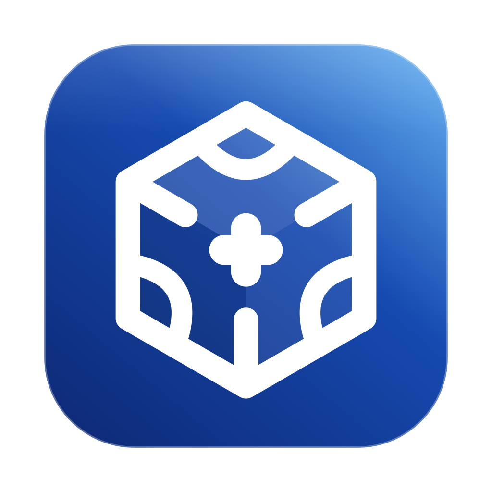

<div align="center">
    
    <h1>Ice++</h1>
    <p>面向 macOS 的菜单栏管理。分区、Ice Bar、预设与自动化。</p>
    <p>仅提供 Apple 芯片构建。系统要求为 macOS 14 及以上。</p>
</div>

<p align="center"><a href="README.md">English</a></p>

[](https://github.com/itworksig/IcePlusPlus/actions/workflows/release.yml)
[](https://github.com/itworksig/IcePlusPlus/releases/latest)

[](LICENSE)

显示名称为 **Ice++**。软件包标识符为 `com.itworksig.iceplusplus`，偏好设置写入该标识。该标识与 `com.jordanbaird.Ice` 相互独立。首次启动时，若旧标识下存在偏好设置，则复制到新标识。辅助功能与屏幕录制授权不会随之转移。仍使用旧标识的构建无法通过「检查更新」安装本软件包，因其要求包内标识符与自身一致。请先手动安装一次磁盘映像。此后的更新要求标识符为 `com.itworksig.iceplusplus`。

## 概述

Ice++ 将菜单栏应用归入「可见」「隐藏」或「始终隐藏」。隐藏中的应用可通过 Ice Bar、快捷键、快捷指令、AppleScript 或 `iceplusplus://` URL scheme 恢复。已保存的布局亦可按当前显示器组合、前台应用、时段或所接入的网络自动应用。

macOS 27 上的隐藏通过系统评估模式的允许列表实现。逐图标的状态项窗口已不存在，故隐藏以整个应用为单位。`com.apple.*` 进程与 Ice 自身保持可见。

## 项目沿革

| 仓库 | 关系 |
| --- | --- |
| [Jordan Baird 的 Ice](https://github.com/jordanbaird/Ice) | 原始项目。分区、Ice Bar、菜单栏外观、图标间距与快捷键均源于此。许可为 GPL-3.0。 |
| [cavaldos/Ice](https://github.com/cavaldos/Ice) | 在 macOS 27 上继续维护 Ice 的社区分支。本仓库的 `upstream` 指向该仓库。分叉点为 `38c8a95`（`fix: remove padding left menubar`）。 |
| [itworksig/IcePlusPlus](https://github.com/itworksig/IcePlusPlus) | 本仓库。 |

分叉点之后，cavaldos 另有 Ice Bar 图标发现、将悬停状态排除出已保存布局，以及更新后请求 star 的提交。上述提交未并入本仓库。

## 功能对照

| | 原始 Ice | cavaldos/Ice | Ice++ |
| --- | --- | --- | --- |
| 产品名称 | Ice | Ice | Ice++。软件包标识符 `com.itworksig.iceplusplus` |
| 界面语言 | 英文 | 英文 | 英文与简体中文。切换语言将重新启动应用 |
| 更新 | Sparkle appcast | 项目 Release，另提供 Homebrew tap `cavaldos/tap` | 关于页查询本仓库的 GitHub Release。未发布 Homebrew formula |
| 分发 | 原始仓库 | cavaldos/Ice | 仅 arm64。推送至 `main` 即发布下一版本。项目中更高的主版本或次版本按所记录的版本发布 |
| macOS 27 隐藏 | 依据当时的逐图标窗口 | 修复图标消失或无法触及的问题，以保留原有布局路径 | 通过评估模式允许列表按应用隐藏 |
| 系统状态项 | 随菜单栏外观 | 随菜单栏外观 | Wi-Fi、电池、时钟与控制中心可独立控制可见性。蓝牙与音量不具备独立开关 |
| Ice Bar | 用于展开隐藏区的二级栏 | 同一栏，其后有激活与图标发现方面的修改 | 玻璃表面，圆角与着色独立于菜单栏外观。搜索范围包括图标、预设与自动化。方向键移动选择，Return 执行。位置取鼠标所在显示器 |
| 预设 | — | — | 可保存当前布局并直接应用。预设可绑定当前显示器组合，并在该组合再次接入时自动应用 |
| 自动化 | — | — | 前台应用、电量、时段、Wi-Fi、地点、日期、电源或脚本。应用自正在运行的进程中选择。网络名称与地点取当前值。时段使用时间选择器 |
| 专注模式 | — | — | 仅隐藏第三方图标。时钟与控制中心保持可见，音量与亮度界面因此继续可用 |
| 刘海避让 | 由布局与 Ice Bar 处理 | 由布局与 Ice Bar 处理 | 默认关闭。启用后，仅当第三方图标的中心位于刘海区域内时才移动该图标。刷新过程不重新启动控制中心 |
| 外部控制 | 快捷键 | 快捷键 | 快捷键、快捷指令、Siri、App Intents、AppleScript、`iceplusplus://`，以及 Raycast 扩展源码 |
| 分组与小组件 | — | — | 由 Ice 持有的状态项。见[平台限制](#平台限制) |
| 配置 | 本地偏好设置 | 本地偏好设置 | 本地偏好设置，并支持导出、导入及恢复最近一次备份 |

以下能力予以保留：三个分区、拖放式布局编辑、菜单栏外观与间距、登录时启动，以及按智能规则、固定间隔或前台应用切换自动收回。辅助功能与屏幕录制仍为必需权限。

## 平台限制

下列限制同时写在布局页中，来自 macOS 27 的系统约束。

- 隐藏以应用为单位。同一应用的多个图标一并移动。
- 蓝牙与音量不在上述四项系统控制之内，保持显示于菜单栏。
- 分组是 Ice 创建的状态项。激活成员后，该应用回到菜单栏约 8 秒。系统不允许将其他应用的状态项并入该菜单项。间隔条与小组件同样归 Ice 所有。
- 配置存储于本机。在 Mac 之间迁移时使用导出文件。未实现 iCloud 同步。

## 安装

发行文件发布于 [Releases](https://github.com/itworksig/IcePlusPlus/releases/latest)。

| 文件 | 用途 |
| --- | --- |
| `Ice-arm64.dmg` | 手动安装。打开磁盘映像后，将 `Ice.app` 移入「应用程序」。 |
| `Ice.zip` | 同一 arm64 应用。「检查更新」以此归档替换正在运行的副本。 |
| `release.json` | 该构建的版本号、构建号与架构。 |

发行文件未经公证。若 Gatekeeper 阻止首次启动，请清除隔离属性：

```bash
xattr -d com.apple.quarantine /Applications/Ice.app
```

随后在「系统设置 → 隐私与安全性」中启用辅助功能与屏幕录制。使用同一签名的后续安装将保留上述授权。自 GitHub 下载的软件包为临时签名，首次替换为该类软件包时，授权可能需要重新启用。

仅当自动化依赖地点或 Wi-Fi 名称，或调用「使用当前位置」「使用当前网络」时，才会请求定位授权。

## 更新机制

关于页的「检查更新」读取本仓库的最新 Release。

1. 读取正在运行的应用的 `CFBundleShortVersionString`。
2. 请求 `https://api.github.com/repos/itworksig/IcePlusPlus/releases/latest`。未认证流量每小时共享 60 次额度。若返回 HTTP 403 或 429，则跟随 `https://github.com/itworksig/IcePlusPlus/releases/latest` 至其解析后的标签，并下载 `Ice.zip`。
3. 将标签 `vX.Y.Z` 与本地版本按数值比较。前缀 `v` 及 `-beta` 一类后缀不参与比较。`1.0` 与 `1.0.0` 视为相等。
4. 远程版本较高即为可用更新。相等或较低表示当前安装已是最新。Release 列表为空时，报告为尚无已发布版本。
5. 「安装并重新打开」下载 `Ice.zip`；若无 zip，则使用 `Ice-arm64.dmg`。包内应用的标识符须为 `com.itworksig.iceplusplus`，版本须更高，且架构须为 arm64。随后替换正在运行的副本并重新启动。

启用自动检查后，Ice++ 在启动时查询一次，此后约每 24 小时查询一次。已安装版本为最新时不显示对话框。启用自动下载后，先下载较新的构建，经确认后再执行安装。

`Info.plist` 中仍保留 Sparkle 的 feed 键。关于页不使用该 appcast。

## 外部控制

```text
iceplusplus://focus
iceplusplus://show-hidden
iceplusplus://hide-hidden
iceplusplus://ice-bar
iceplusplus://preset?name=办公室
```

AppleScript 中的应用名称为 `Ice++`。命令文本与 URL 主机名一致。预设以 `preset:` 加名称寻址。

```applescript
tell application "Ice++" to do command "focus"
tell application "Ice++" to do command "preset:办公室"
```

快捷指令与 Siri 提供以下 App Intent：切换专注模式、显示隐藏区、隐藏隐藏区、显示 Ice Bar、应用预设。

`raycast/ice-plusplus` 为通过上述 URL scheme 调用 Ice++ 的 Raycast 扩展源码。克隆本仓库不会安装该扩展。

## 发布流程

推送至 `main` 将启动 [Release 工作流](.github/workflows/release.yml)。若 Xcode 项目中的主版本或次版本高于最新 GitHub Release，则按项目所记录的版本发布。同一主次版本上的后续推送，取项目版本与最新 Release 中的较高者，再将末位加一。项目当前记录为 **28.0.0**。`vX.Y.Z` 标签由工作流创建。

该任务运行于提供 Xcode 27 的 `xcode-27` Apple 芯片镜像。它上传 `Ice.zip`、`Ice-arm64.dmg` 与 `release.json`，再将已发布的版本号写回项目。相应提交信息包含 `[skip ci]`，因此这次写回不会再次触发发布。

亦可在 Actions 页面手动运行 **Release Apple silicon**。

若未能分配到 Mac 托管运行器，且任务在任何步骤执行之前被取消，[重试工作流](.github/workflows/retry-release.yml) 会重新排队，最多三次。执行开始之后的失败不由该工作流重试。

本仓库为 fork。在 [Actions](https://github.com/itworksig/IcePlusPlus/actions) 页面启用之前，GitHub Actions 不会运行。启用之前的推送不会被补执行。

## 开发

本地构建需要 Xcode.app 与 macOS 27 SDK。调试产物安装至 `/Applications/Ice-Dev.app`，并使用登录钥匙串中的 **Ice Dev** 证书签名，从而使辅助功能与屏幕录制授权在重新编译后仍然有效。命令见 [script/README.md](script/README.md)。

## 许可

本软件依 [GPL-3.0](LICENSE) 分发。Ice++ 基于 Jordan Baird 的 [Ice](https://github.com/jordanbaird/Ice)，以及 [cavaldos/Ice](https://github.com/cavaldos/Ice) 在 macOS 27 上的维护工作。
